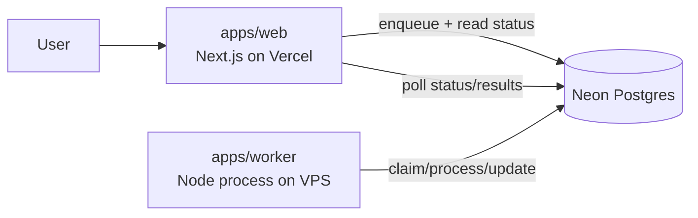

# WebHealth

A queue-first SEO reporting platform with a clean production split:

- `apps/web` on Vercel for product UI + short request/response APIs
- Neon Postgres for state, queueing, leases, and analytics data
- `apps/worker` for long-running report processing

## Architecture



## Service Boundaries

| Service | Responsibility | Must Not Do |
|---|---|---|
| `apps/web` | Render UI, authenticate, enqueue jobs, read report/job state | Run long background report generation in HTTP handlers |
| `apps/worker` | Claim jobs, process report pipeline, write status/events/artifacts | Serve product UI |
| Neon Postgres | Queue + source of truth (`report_jobs`, `reports`, events) | App-specific orchestration logic |

## Monorepo Layout

```text
apps/
  web/        # @webhealth/web
  worker/     # @webhealth/worker
packages/
  shared/     # @webhealth/shared (db + queue + report core)
drizzle/      # SQL migrations
```

## Runbooks

- Local macOS: `docs/how-to-run-locally-macos.md`
- Deploy (Vercel + Neon + Worker VPS): `docs/deploy-runbook.md`
- GlitchTip monitoring: `docs/glitchtip.md`

## Neon Connection Rules (Strict)

Web and worker enforce these rules at runtime:

- `DATABASE_URL` must use **pooled** Neon host (`-pooler`) and include `sslmode=require`
- `DIRECT_DATABASE_URL` must use **direct** Neon host (no `-pooler`) and include `sslmode=require`

### Required env patterns

```bash
# Runtime (web + worker)
DATABASE_URL=postgresql://<user>:<pass>@<project>-pooler.<region>.neon.tech/<db>?sslmode=require

# Migrations/tooling + worker startup migrations
DIRECT_DATABASE_URL=postgresql://<user>:<pass>@<project>.<region>.neon.tech/<db>?sslmode=require
```

Guardrails are implemented in:

- `packages/shared/src/db/url-guards.ts`
- `packages/shared/src/db/index.ts`
- `drizzle.config.ts`

## Quick Start

### 1) Install

```bash
pnpm install
```

### 2) Configure env

Use placeholders from:

- `.env.example`
- `apps/web/.env.example`
- `apps/worker/.env.example`

### 3) Run services

```bash
# web
pnpm dev

# worker
pnpm worker

# single worker tick
pnpm worker:once
```

## Database Commands

All run from repository root:

```bash
pnpm db:migrate
pnpm db:push
pnpm db:seed:plan-settings
```

Worker startup automatically ensures migrations before entering the job loop.
Migration tooling remains pinned to `DIRECT_DATABASE_URL` via `drizzle.config.ts`.

## Deploy `apps/web` on Vercel

1. Import this repository in Vercel.
2. Set project **Root Directory** to `apps/web`.
3. Ensure Vercel uses `pnpm` (`packageManager` is pinned at repo root).
4. Recommended commands:
   - Install: `pnpm install --frozen-lockfile`
   - Build: `pnpm build`
5. Add required env vars in Vercel:
   - `DATABASE_URL` (pooled, `-pooler`, `sslmode=require`)
   - `BETTER_AUTH_URL`
   - `NEXT_PUBLIC_BETTER_AUTH_URL`
   - `BETTER_AUTH_SECRET`
   - `GOOGLE_CLIENT_ID`
   - `GOOGLE_CLIENT_SECRET`
   - `GOOGLE_OAUTH_STATE_SECRET`
   - `OPENAI_API_KEY`
6. Pull envs locally when needed:

```bash
vercel env pull .env.local
```

Troubleshooting:

- If Vercel shows `No Next.js version detected`, the project is building from the wrong directory.
  - Fix: set **Root Directory** to `apps/web` (this is required in this monorepo).
- If Vercel logs show an older commit than expected, redeploy from the latest `main` commit and verify Production Branch is `main`.

## Run Worker on VPS (systemd)

Example unit (`/etc/systemd/system/webhealth-worker.service`):

```ini
[Unit]
Description=WebHealth Report Worker
After=network.target

[Service]
Type=simple
WorkingDirectory=/opt/webhealth
EnvironmentFile=/etc/webhealth/worker.env
ExecStart=/usr/bin/pnpm --filter @webhealth/worker start
Restart=always
RestartSec=5
User=webhealth

[Install]
WantedBy=multi-user.target
```

Enable and start:

```bash
sudo systemctl daemon-reload
sudo systemctl enable webhealth-worker
sudo systemctl start webhealth-worker
sudo systemctl status webhealth-worker
```

## Queue-Only Processing Contract

- `POST /api/reports/[id]/process` is intentionally disabled and returns `410`.
- Report execution is performed only by `apps/worker` from queued jobs.
- Web routes enqueue/requeue and read state; they do not run long pipelines inline.

## Security Notes

- Do not commit real credentials.
- Keep only placeholders in `*.env.example`.
- Rotate auth/API secrets before production rollout.
