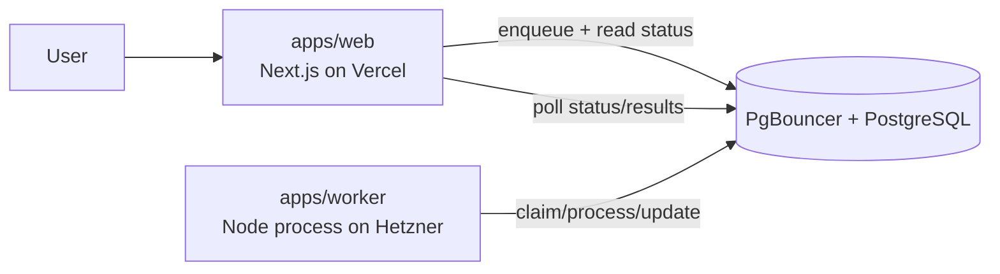

# WebHealth

A queue-first SEO reporting platform with a split production architecture:

- `apps/web` on Vercel for UI and short request/response APIs
- self-hosted PostgreSQL + PgBouncer on Hetzner for state, queueing, leases, and analytics data
- `apps/worker` on Hetzner for long-running report processing

## Architecture



## Service Boundaries

| Service | Responsibility | Must Not Do |
|---|---|---|
| `apps/web` | Render UI, authenticate, enqueue jobs, read report/job state | Run long background report generation in HTTP handlers |
| `apps/worker` | Claim jobs, process report pipeline, write status/events/artifacts | Serve product UI |
| PostgreSQL | Queue + source of truth (`report_jobs`, `reports`, events) | App-specific orchestration logic |

## Monorepo Layout

```text
apps/
  web/        # @webhealth/web
  worker/     # @webhealth/worker
packages/
  shared/     # @webhealth/shared (db + queue + report core)
drizzle/      # SQL migrations
infra/
  self-hosted-postgres/  # Coolify-ready database/ops stack
  monitoring/            # Coolify-ready Prometheus + Grafana stack
```

## DB Connection Contract

Web and worker keep two distinct database URLs:

- `DATABASE_URL`: pooled runtime endpoint through PgBouncer
- `DIRECT_DATABASE_URL`: direct Postgres endpoint for Drizzle migrations, worker startup migrations, and `LISTEN/NOTIFY`

Both URLs must be valid Postgres URLs and include `sslmode=require`.

### Example envs

```bash
DATABASE_URL=postgresql://<runtime-user>:<pass>@db.webhealth.devbrew.dev:6432/webhealth?sslmode=require
DIRECT_DATABASE_URL=postgresql://<direct-user>:<pass>@<private-host-or-predefined-network-name>:5432/webhealth?sslmode=require
```

Guardrails live in:

- [url-guards.ts](/Users/cancelcloud/Developer/DevBrew/WebHealth/packages/shared/src/db/url-guards.ts)
- [index.ts](/Users/cancelcloud/Developer/DevBrew/WebHealth/packages/shared/src/db/index.ts)
- [drizzle.config.ts](/Users/cancelcloud/Developer/DevBrew/WebHealth/drizzle.config.ts)

## Quick Start

1. Install dependencies with `pnpm install`.
2. Copy placeholders from `.env.example`, `apps/web/.env.example`, and `apps/worker/.env.example`.
3. Run `pnpm dev` for the web app and `pnpm worker` for the worker.

## Database Commands

Run from repo root:

```bash
pnpm db:migrate
pnpm db:push
pnpm db:seed:plan-settings
```

Worker startup automatically ensures migrations before entering the job loop.

## Runbooks

- Local macOS: [docs/how-to-run-locally-macos.md](/Users/cancelcloud/Developer/DevBrew/WebHealth/docs/how-to-run-locally-macos.md)
- Full deploy: [docs/deploy-runbook.md](/Users/cancelcloud/Developer/DevBrew/WebHealth/docs/deploy-runbook.md)
- DB stack operations: [docs/self-hosted-postgres-operations.md](/Users/cancelcloud/Developer/DevBrew/WebHealth/docs/self-hosted-postgres-operations.md)
- Monitoring stack: [infra/monitoring/README.md](/Users/cancelcloud/Developer/DevBrew/WebHealth/infra/monitoring/README.md)
- Neon migration + cutover: [docs/self-hosted-postgres-migration.md](/Users/cancelcloud/Developer/DevBrew/WebHealth/docs/self-hosted-postgres-migration.md)
- GlitchTip monitoring: [docs/glitchtip.md](/Users/cancelcloud/Developer/DevBrew/WebHealth/docs/glitchtip.md)

## Queue-Only Processing Contract

- `POST /api/reports/[id]/process` is intentionally disabled and returns `410`.
- Report execution is performed only by `apps/worker` from queued jobs.
- Web routes enqueue/requeue and read state; they do not run long pipelines inline.

## Security Notes

- Do not commit real credentials.
- Keep only placeholders in `*.env.example`.
- Rotate auth/API secrets before production rollout.
